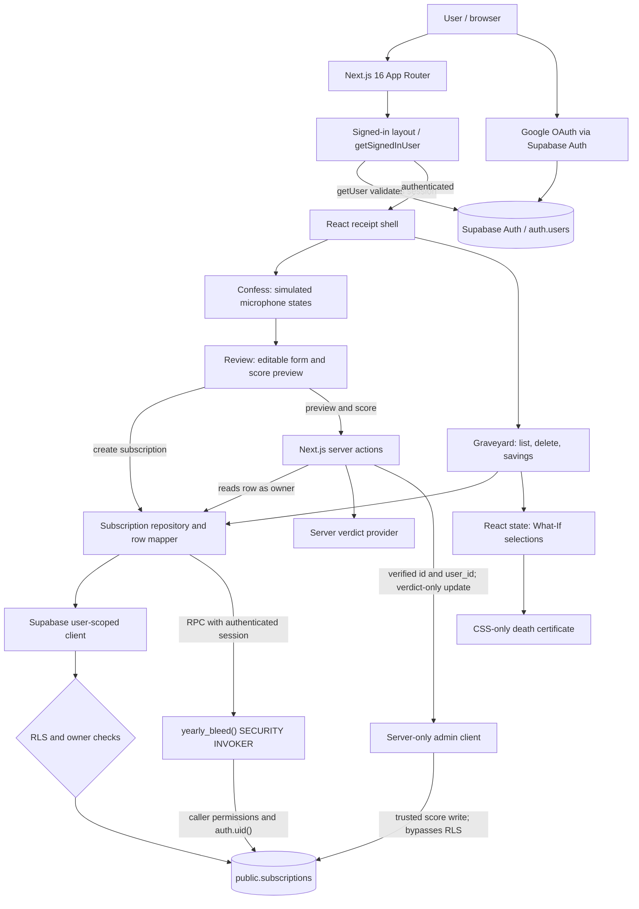
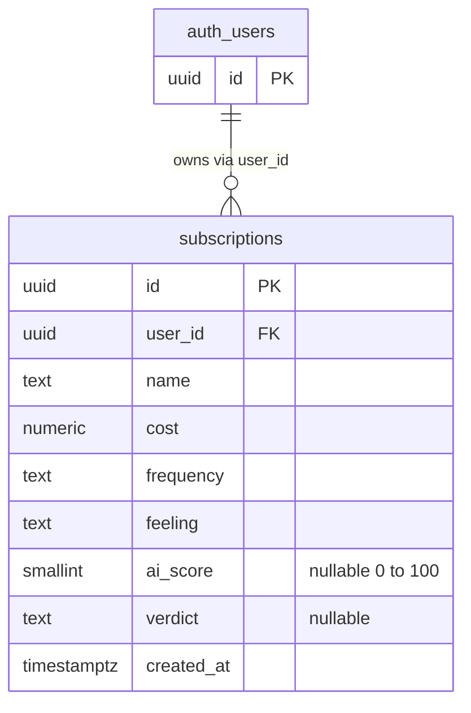
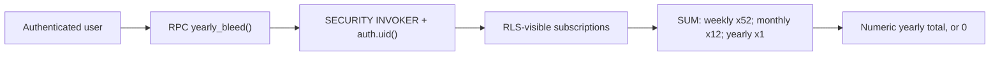

# SubKiller — System Architecture and Database Diagrams

These Mermaid diagrams describe the current application and migration-defined schema. They do not attest that migrations have been applied to a particular remote Supabase instance.

## System architecture

**Trust boundaries.** A signed-in session is validated by Supabase Auth before entering the receipt shell. Ordinary subscription reads and writes use the authenticated user client, explicit `user_id` filters, and PostgreSQL row-level security. The admin client is server-only and records a verdict after the subscription owner has been confirmed with the user-scoped client. Temporary What-If cancellation selections and the CSS poster remain in React/UI state and do not change the stored ledger. The microphone flow is simulated; audio is not stored or transcribed.

## Database schema

The `auth_users` shape represents **Supabase-managed `auth.users`**, not a separate application table. `public.subscriptions.user_id` references `auth.users(id)` with `ON DELETE CASCADE`. The application has no separate `profiles` table in its committed database types or cited migrations.

### Database constraints and security

- `subscriptions.id`: UUID primary key, defaults to `gen_random_uuid()`.
- `subscriptions.user_id`: non-null UUID, defaults to `auth.uid()`, and references `auth.users(id)`.
- `name`: nonblank after trimming, 1–100 characters; `cost`: positive `numeric(10,2)`; `frequency`: `weekly`, `monthly`, or `yearly`; `feeling`: at most 1,000 characters.
- `ai_score`: nullable integer 0–100; `verdict`: nullable text at most 500 characters; both must be null together or populated together.
- Owner-based SELECT, INSERT, UPDATE and DELETE RLS policies require `auth.uid() = user_id`. Authenticated clients may insert `user_id`, `name`, `cost`, `frequency`, and `feeling`, and may update the last four; they cannot directly set `ai_score` or `verdict`.
- A server-only admin client may write verdict columns after a prior owner check. The update matches `id`, `user_id`, and an unscored row to prevent overwriting an existing verdict.
- `subscriptions_user_id_created_at_idx` supports per-user newest-first lists.

### Database function: `yearly_bleed()`

The zero-argument function returns `numeric`, runs with caller privileges, and is executable by `authenticated` but not `anon`. It does not accept a user ID supplied by the browser. This function is not a database table or relationship.

### Verified repository sources

- `supabase/migrations/20261030174808_create_subscriptions.sql`
- `supabase/migrations/20261104120000_create_yearly_bleed.sql`
- `src/lib/supabase/database.types.ts`
- `src/lib/subscriptions/repository.ts`
- `src/lib/ai/score-subscription.ts`
- `src/app/(app)/review/actions.ts`
- `src/app/(app)/layout.tsx`
- `src/components/receipt/GraveyardView.tsx`

These diagrams document the code and migrations, not the live remote database state.
